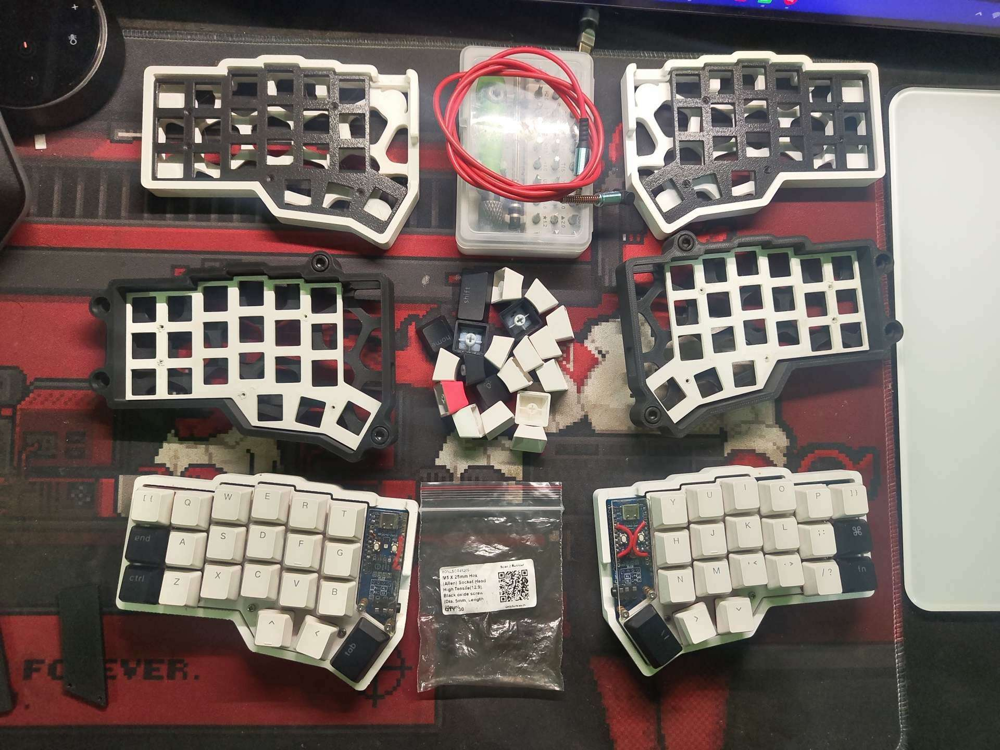

# The Split Way

An interactive field guide to split keyboards: explore the layout, understand the parts, and follow the build from soldering through firmware and first troubleshooting checks.

**Repository description:** A hands-on guide to split keyboard layouts, parts, soldering, firmware, and troubleshooting.

## Explore the guide

Visit [the live site](https://kimiikkk.github.io/the-Split-way/) once GitHub Pages is enabled for this repository.

The interactive 3D model can be rotated, resized, split, tented, and dismantled by layer. The guide covers keyboard layouts, controllers and MCUs, switches, keycaps, matrices, diodes, soldering, firmware, first-boot checks, and troubleshooting.



The 3D model is illustrative. Component placement, dimensions, and wiring do not specify a particular kit or pinout. Follow the documentation for the PCB and controller you are building.

## Run locally

Serve the repository root over HTTP so the browser can load the JavaScript modules:

```sh
python -m http.server 8000
```

Then open <http://localhost:8000>. Three.js is bundled locally. The typefaces load from Google Fonts when online and fall back to system fonts when offline.

## Publish with GitHub Pages

This is a plain static site and has no build step. In the repository, open **Settings → Pages**, choose **Deploy from a branch**, select `main` and `/(root)`, then save. The site will be available at `https://kimiikkk.github.io/the-Split-way/` after Pages finishes its first deployment.

## Project files

- `index.html` — guide content and accessible page structure
- `styles.css` — responsive layout and visual design
- `script.js` — chapter navigation and reading progress
- `keyboard-3d.js` — interactive keyboard model
- `vendor/three/` — locally bundled Three.js modules and license
- `assets/` — example build photo
